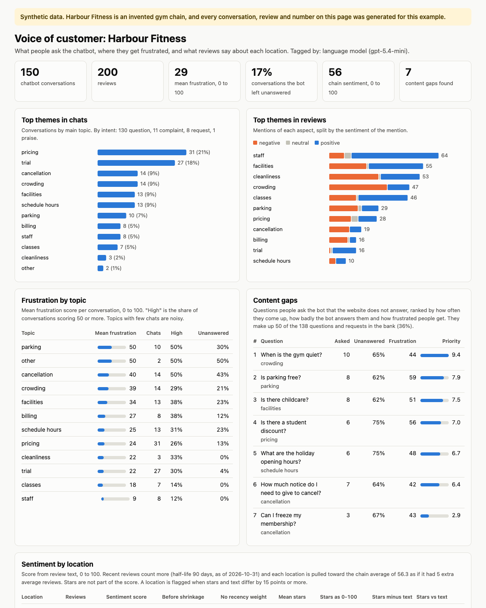
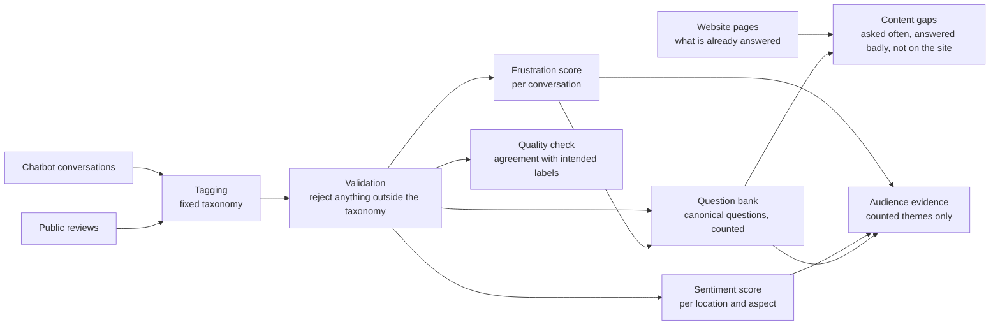

# voice-of-customer

Chatbot conversations and public reviews go in. Tagged themes, a frustration score per conversation, a sentiment score per location and a question bank come out. The question bank shows what people actually ask, and which of those questions the website does not answer.



*The top of the report from the model run. The full page is in [`docs/example-report.html`](docs/example-report.html).*

**All data here is synthetic.** "Harbour Fitness" is an invented gym chain with four invented locations. Every conversation, review and website page was written by a seeded generator in this repo. There are no names, emails or phone numbers anywhere. This is an example of an approach on made-up data, not a production system.

## Why

A support chatbot and a review page both collect what customers say in their own words. Most of it is never counted. This project counts it in four ways:

1. **Themes.** What each conversation and review is about, from a fixed list.
2. **Frustration.** A score per conversation, from signals such as asking twice or asking for a human.
3. **Location sentiment.** A score per location from review text, with star ratings kept beside it.
4. **Question bank.** The questions people type, grouped, counted, and checked against the website. This is the input for answer-engine optimisation (AEO): if people ask it and the site does not answer it, a search engine or an AI assistant has nothing of yours to quote.

## How it works



1. **Data.** [`voc/generate.py`](voc/generate.py) writes 150 conversations, 200 reviews and a list of website pages. Each item carries a hidden `intended` block: the labels it was generated from.
2. **Tagging.** Two taggers share one interface. `KeywordTagger` is a set of offline rules and is the baseline. `ModelTagger` sends batches of about 18 items to a language model with a strict JSON schema. A tagger only ever sees an item's id and text. The intended labels, the location, the date and the star rating are held back.
3. **Validation.** An answer with a value outside the taxonomy, a missing field, an extra field or an unknown id is dropped and recorded. It is not repaired.
4. **Scores.** Described below.
5. **Question bank.** Each question or request is mapped to a canonical question by its topic tag and a few key phrases. Each canonical question gets a count, the share the bot left unanswered, a mean frustration score and a flag for whether the website covers it.
6. **Quality.** Each tagger is compared with the intended labels, field by field.
7. **Report.** One HTML file with inline CSS and SVG. No scripts and no external requests.

## Run it

You need Python 3.12 or newer and [uv](https://docs.astral.sh/uv/). There are no runtime dependencies.

```bash
uv sync
uv run pytest
```

The tests make no API calls. To rebuild everything in the keyword run:

```bash
uv run python -m voc generate
uv run python -m voc tag --tagger keyword --out results/keyword
uv run python -m voc score --out results/keyword
uv run python -m voc report --out results/keyword
```

To tag with a model you need an API key. It is read from the environment and sent in a header.

```bash
export OPENAI_API_KEY=...
uv run python -m voc tag --tagger model --out results/model --max-calls 30
uv run python -m voc score --out results/model
uv run python -m voc report --out results/model
```

The model is `gpt-5.4-mini` unless `VOC_MODEL` is set. A full run is 21 calls: 9 for conversations and 12 for reviews. `--max-calls` is a hard limit. When it is reached the run stops and keeps what it has. Nothing is retried. When both `results/keyword` and `results/model` exist, the report shows the two taggers side by side.

## Taxonomy

Everything lives in [`voc/taxonomy.py`](voc/taxonomy.py). The prompts and the JSON schemas are built from it.

| Field | Applies to | Values |
| --- | --- | --- |
| topic | chats | pricing, trial, cancellation, billing, schedule_hours, classes, facilities, cleanliness, crowding, staff, parking, other |
| intent | chats | question, complaint, praise, request |
| answered | chats | yes, partly, no |
| signals | chats | any of: repeated_question, bot_misunderstood, asked_for_human, negative_language, gave_up |
| aspects | reviews | for each topic the review mentions (all of the above except "other"): negative, neutral or positive |

## How the scores are computed

All weights are in constants at the top of [`voc/scores.py`](voc/scores.py) and [`voc/questions.py`](voc/questions.py). They are judgement calls. None of them is fitted to an outcome.

### Frustration, per conversation

Points are added and the total is capped at 100.

| Input | Points |
| --- | --- |
| answered: yes / partly / no | 0 / 10 / 25 |
| repeated_question | 20 |
| bot_misunderstood | 15 |
| asked_for_human | 25 |
| negative_language | 20 |
| gave_up | 25 |

A conversation at 50 or more is counted as "high".

### Sentiment, per location

| Step | Rule |
| --- | --- |
| Aspect value | negative 0, neutral 50, positive 100 |
| Review score | mean of the aspect values in the review. A review that mentions no aspect is not scored. |
| Recency | a review's weight halves every 90 days |
| Location score before shrinkage | weighted mean of its review scores |
| Shrinkage | (weight x own score + 5 x chain score) / (weight + 5). A location with little recent data sits close to the chain average. |
| Aspect breakdown | the same, per aspect, pulled toward that aspect's chain average. Fewer than 5 mentions is marked as thin. |
| Stars | never part of the score. The mean star rating is put on the same 0 to 100 scale and shown beside the text score. A gap of 15 points or more is flagged. |

### Content gaps

| Step | Rule |
| --- | --- |
| Which chats | intent is question or request |
| Unanswered share | "no" counts 1, "partly" counts 0.5 |
| Gap | not covered by `data/site_pages.json`, asked at least 3 times, not a general bucket |
| Priority | count x unanswered share x (1 + mean frustration / 100) |

## Results

These are real numbers from two committed runs: the keyword baseline in [`results/keyword`](results/keyword) and one real model run in [`results/model`](results/model) (21 API calls, all 350 items returned valid tags). "Agreement" is the share of items where the tagger gives the label the text was generated from.

| Field | Keyword baseline | Model (`gpt-5.4-mini`) |
| --- | --- | --- |
| Chat: topic | 136/150 (91%) | 140/150 (93%) |
| Chat: intent | 143/150 (95%) | 142/150 (95%) |
| Chat: answered | 114/150 (76%) | 132/150 (88%) |
| Chat: all frustration signals exactly right | 101/150 (67%) | 94/150 (63%) |
| Chat: frustration score within 10 points | 94/150 (63%) | 98/150 (65%) |
| Chat: canonical question | 126/137 (92%) | 124/137 (91%) |
| Review: intended aspects found | 343/376 (91%) | 375/376 (100%) |
| Review: tagged aspects that were intended | 343/345 (99%) | 375/383 (98%) |
| Review: sentiment right on aspects found | 230/343 (67%) | 355/375 (95%) |
| Review: whole review exactly right | 93/200 (46%) | 174/200 (87%) |

What I take from the model run:

- **The model reads tone, and that fixes the review side.** Sentiment on a found aspect goes from 67% to 95%, and whole reviews exactly right from 46% to 87%. Chain sentiment comes out at 56.3 against 55.7 from the intended labels, and the stars-versus-text flag lands on the right location, Quayside.
- **It is no better at scoring frustration.** The frustration score is within 10 points for 65% of chats, about the same as the keyword rules. The model catches every request for a human and every angry message, but it finds only 13 of the 47 conversations where the bot misunderstood (precision 93%, recall 28%).
- **It is too kind to the bot.** It says 17% of questions went unanswered. The intended figure is 27%, and the keyword rules said 46%. The two taggers are wrong in opposite directions, so neither number should be reported as the bot's failure rate without a labelled sample.
- **The content gap list still holds.** Four of the model run's top five gaps are in the intended top five. Its top gaps: "When is the gym quiet?", "Is parking free?", "Is there childcare?", "Is there a student discount?" and "What are the holiday opening hours?".

Frustration signals for the model, as precision / recall: repeated_question 78% / 80%, bot_misunderstood 93% / 28%, asked_for_human 96% / 100%, negative_language 96% / 100%, gave_up 92% / 92%.

Frustration signals for the baseline, as precision / recall: repeated_question 96% / 86%, bot_misunderstood 100% / 51%, asked_for_human 100% / 72%, negative_language 100% / 65%, gave_up 76% / 54%.

What I take from the baseline run:

- **Keywords find the subject. They do not read the tone.** Topic and aspect are right about nine times in ten. Sentiment on a found aspect is right two times in three. Sarcasm, and complaints with no negative word in them, come out neutral or positive.
- **The errors lean one way, and that moves the scores.** Because the data is synthetic, each score can be recomputed from the intended labels. The baseline puts chain sentiment at 60.6 where the intended labels give 55.7. It says the bot left 46% of conversations unanswered where the intended figure is 27%, because its rule treats "I do not have that detail" as no answer when the bot had answered partly.
- **It misses half of the bot's misunderstandings.** It catches "Sorry, I did not understand". It cannot see a confident answer to a different question.
- **The stars-versus-text flag is wrong in the baseline run.** One location, Quayside, was generated with star ratings more generous than its review text. From the intended labels it is the only location flagged. The baseline flags Millbrook and misses Quayside. A flag built on a sentiment tagger is only as good as the tagger.
- **The content gap list holds up anyway.** The top five gaps from the baseline are the same five as from the intended labels, in a slightly different order. Counting questions needs the topic, and the topic is the easy part.

The top gaps in the baseline run: "Is parking free?", "When is the gym quiet?", "Can I bring a guest?", "Is there a student discount?" and "What are the holiday opening hours?". Questions the site does not cover are 57 of the 138 questions and requests in the bank.

## Background

This is a small public version of something I built at my job. There, a larger private system tags chatbot conversations for the questions people ask and where they get frustrated, and scores each conversation. It also reads public reviews and turns them into a sentiment score per location. Both feed the audience definitions used for creative work, and the question bank guides content for search and AI answers, because it shows what people actually type. Only counted themes are kept, never text about a person. That system is private. Nothing here comes from it: no code, no data, no prompts.

Related repos:

- [audience-to-creative](https://github.com/mert-atalay/audience-to-creative): from audience evidence to creative briefs.
- [creative-tagger](https://github.com/mert-atalay/creative-tagger): tagging ad images against a fixed taxonomy and checking the tags.

## Limits

- **The data is synthetic, and synthetic text is easier than real text.** It is built from a few hundred phrase fragments. I wrote the fragments, the keyword rules and the question groups, so the rules fit the text better than they would fit real customers. Real chats have more topics per message, more languages, more spelling variety and far more ways to be annoyed. Expect every agreement number here to drop on real data.
- **The reference is the generator's intent, not a person's reading.** Some generated lines are ambiguous on purpose, and a careful human could disagree with the intended label. A proper calibration set is a few hundred real items labelled by two people, with their agreement measured first.
- **The score weights are judgement calls.** They are not fitted to churn, complaints, or anything else. The half-life, the shrinkage strength and the 15 point flag are the same kind of choice.
- **The planted patterns are found because they were planted.** Each location has a built-in profile, and the unanswered questions were chosen up front. The report recovering them shows the pipeline works, not that it discovers things.
- **Question grouping is rule based.** New questions land in a general bucket until someone adds a rule. Grouping by embeddings would cope better with wording it has not seen.
- **One conversation gets one topic.** A chat that asks about price and parking is counted once.
- **Website coverage is a hand-written list.** A real version would crawl the site and judge whether a page answers the question.
- **Small numbers.** 150 conversations and 200 reviews. One location has 14 reviews. Several topics have fewer than ten conversations.
- **The model run is one run of one model.** It was not repeated, so I have not measured how stable its tags are from run to run. No retries: a failed call stops the run.
- **No statistics beyond shrinkage and a minimum count.** No confidence intervals.
- **No storage and no schedule.** It reads JSON files and writes JSON and HTML.

## Layout

```
data/chats.json          150 synthetic conversations with intended labels
data/reviews.json        200 synthetic reviews with intended labels
data/site_pages.json     which questions the invented website answers
voc/generate.py          the seeded generator
voc/taxonomy.py          closed lists, JSON schemas, prompts, validators
voc/tagger.py            KeywordTagger, ModelTagger and the batch runner
voc/client.py            OpenAI client over urllib with a call budget
voc/scores.py            frustration and location sentiment
voc/questions.py         question bank and content gaps
voc/quality.py           agreement with the intended labels
voc/summary.py           everything the report needs from one run
voc/report.py            the HTML report
results/keyword/         tags, scores and report from the baseline run
docs/                    example report and screenshot
tests/
```

## License

MIT. See [LICENSE](LICENSE).
